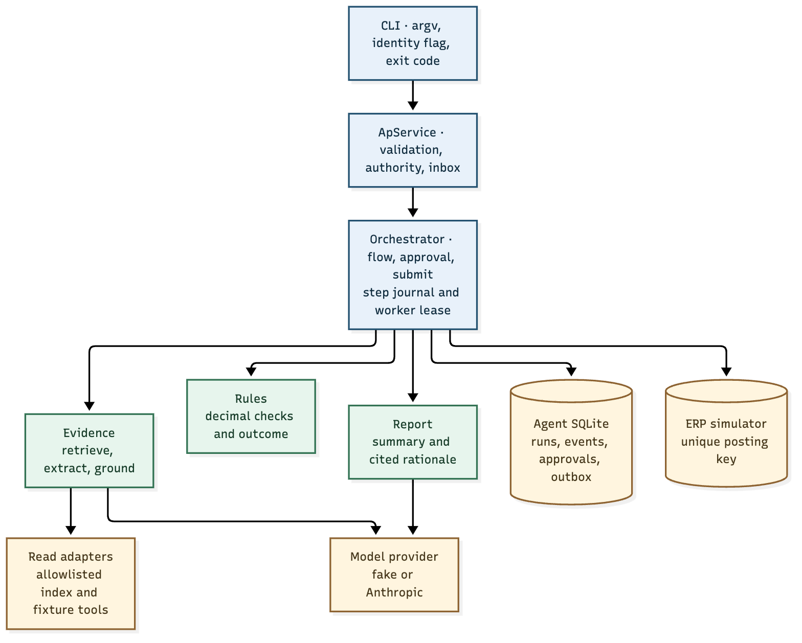

# Architecture and configuration

The CLI takes a case to a proposal. Only the approval and submit path can turn it into a simulated ERP decision. The arrows show which component requests work from which dependency.

[Mermaid diagram source](architecture.mmd)

| Component | Implementation and trust boundary | Configuration |
| --- | --- | --- |
| Operator interface | Local CLI, real process and JSON exit protocol. The approver flag simulates authenticated identity. | Run from the repository root. Compose uses a named volume. |
| Agent runtime | TypeScript state machine, journaled steps, renewable per-run lease and transactional approval inbox. | Node 22, validated request metadata, 60 s CLI deadline. |
| Document index | Local BM25 retrieval over 58 sections in 15 supplied Markdown documents. Document text is untrusted. An external allowlist and effective windows determine policy authority. | `corpus/trust.json`, `ap ingest`, `DATA_DIR/index.json`. |
| Model provider | Deterministic invoice parser/scripted fake by default. The Anthropic adapter calls the Messages API for extraction and rationale only. | `MODEL_PROVIDER`, `ANTHROPIC_API_KEY`. The adapter selects `claude-haiku-4-5-20251001`. |
| Evidence tools | Simulated vendor records, PO lines and receipts, and invoice history. Local retrieval is real. Evidence validates arguments and results. | JSON under `fixtures/`. Faults in a case configure the simulated backends. |
| Rule engine | Pure decimal calculations, policy findings and required approver role. | Reviewed TypeScript checks and policy version references. |
| Report | Zod-validated recommendations with source references, calculations, exceptions and next action. Code sets the decision summary. | Explanation text must cite the findings the run actually produced. |
| Run store | Real SQLite with forward SQL migrations. Holds runs, step outputs, audit, approvals, inbox and outbox. | `DATA_DIR/ap.db`, default directory `data/`. |
| Finance system | Separate SQLite simulator with a unique idempotency key and unique vendor/invoice pair. Read-only recovery lookup by key. | `DATA_DIR/erp-sim.db`. Accepts POST or REJECT_INVOICE. |

An attachment can support an invoice quantity or show a supplier's request. Authority to change a financial decision comes from the delegation register, the recorded human decision and the frozen approval snapshot. Full synthetic bank details live in the fixture boundary. The tool result exposes only the last four digits.
